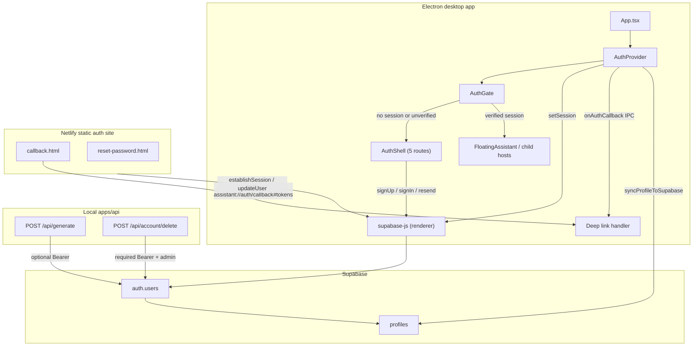

# Authentication Architecture (Reply Assistant)

**Last verified:** May 2026  
**Audience:** engineers, agents, and reviewers working on identity, Supabase, Electron, or account settings.

This document is the **single source of truth** for auth in Reply Assistant. Read it before adding screens, changing session handling, touching Supabase auth config, or modifying the Netlify callback site.

**Related docs (read in this order for backend setup):**

| Doc | Purpose |
|-----|---------|
| [`supabase/FRESH_PROJECT_SETUP.md`](./supabase/FRESH_PROJECT_SETUP.md) | Fresh Supabase project, SQL run order, dashboard auth settings, manual QA |
| [`supabase/README.md`](./supabase/README.md) | Table inventory, May 2026 GRANT policy, env key mapping |
| [`netlify-auth/README.md`](./netlify-auth/README.md) | Static callback site deploy, redirect URLs, deep link |
| [`improvement.md`](./improvement.md) | Product roadmap; auth shipped items + invariants |
| [`next-step.md`](./next-step.md) | Engineering handoff, verify scripts, do-not-break checklist |

---

## Product model (local-first)

Reply Assistant is a **desktop-local-first** workbench. Auth adds a **cloud identity shell** — not a cloud database for contacts or drafts.

| Data | Storage | Auth involvement |
|------|---------|------------------|
| Contacts, memory, drafts, queues, settings | Electron renderer `localStorage` | None (stays local after sign-in) |
| Display name, phone, referral code (cloud copy) | Supabase `profiles` | Synced on verified login + Account Settings edits |
| Session tokens | Supabase client persistence in renderer `localStorage` | `supabase-js` auto-refresh |
| AI telemetry (`user_id` on logs) | Supabase via `apps/api` service role | Optional Bearer token on `/api/generate` |
| Account deletion | Supabase `auth.users` via API admin | Requires Bearer token |

**Do not** move contact threads or message history into Supabase unless the user explicitly approves a cloud-backup architecture change (`profiles.cloud_backup_opt_in` exists for future opt-in only).

---

## High-level architecture



### Auth provider stack

Every renderer entry point wraps the same stack:

```
AuthProvider → AuthGate → { FloatingAssistant | DetachedMiniScreenHost | GeneratedReplyDetachedHost }
```

See [`apps/web/src/App.tsx`](./apps/web/src/App.tsx).

---

## End-to-end flows

### Sign up + email verification

1. User completes **Sign up** in `SignUpScreen` → `supabase.auth.signUp()` with `emailRedirectTo` pointing at Netlify callback (`authConfig.ts`).
2. Supabase sends verification email.
3. User opens link → Netlify [`callback.html`](./netlify-auth/auth/callback.html) establishes session (hash tokens or PKCE).
4. Success UI → **Open Reply Assistant** → deep link `reply-assistant://auth/callback#access_token=...&refresh_token=...`.
5. Electron [`main.ts`](./electron/main.ts) parses URL → IPC `auth-callback` → preload `onAuthCallback`.
6. `AuthProvider` calls `supabase.auth.setSession()`.
7. `email_confirmed_at` is set → `AuthGate` passes → workbench loads.
8. `applyVerifiedAuthUserToProfile()` + `syncProfileToSupabase()` run.

### Sign in

1. `SignInScreen` → `signInWithPassword`.
2. If `email not confirmed` → navigate to **Verify email** with resend.
3. If credentials wrong → inline error (no navigation).
4. On success with verified email → `AuthGate` passes automatically via `onAuthStateChange`.

### Forgot password (logged out)

1. `ForgotPasswordScreen` → `resetPasswordForEmail` with `redirectTo` = Netlify reset page.
2. User sets new password on Netlify [`reset-password.html`](./netlify-auth/auth/reset-password.html).
3. Optional deep link back to desktop; user signs in with new password.

### Change password (logged in)

1. Settings → Account settings → **Change password**.
2. `AccountSettings` embeds `<AuthShell initialRoute="change-password" />` (in-panel overlay, **not** full-window AuthGate).
3. `ChangePasswordScreen` → `supabase.auth.updateUser({ password })` directly in the desktop app.

### Sign out

**Main window:** close child screens → `supabase.auth.signOut()` → `AuthGate` shows `AuthShell`.

**Child window:** `signOut()` sends IPC `{ type: 'sign-out' }` to main → `FloatingAssistant.handleSignOutFromApp()`.

### Delete account

1. Account settings → Delete account → confirmation checkbox.
2. `requestAccountDeletion()` → `POST /api/account/delete` with `Authorization: Bearer <access_token>`.
3. API validates token via service role → `supabase.auth.admin.deleteUser(userId)`.
4. `profiles` row cascades (FK). **Local `localStorage` data is not wiped.**

---

## Frontend module map

All auth UI and client logic lives under [`apps/web/src/auth/`](./apps/web/src/auth/).

### Orchestration

| File | Responsibility |
|------|----------------|
| [`AuthProvider.tsx`](./apps/web/src/auth/AuthProvider.tsx) | Session state, `onAuthStateChange`, deep-link `setSession`, profile sync on verified login, `signOut` |
| [`AuthGate.tsx`](./apps/web/src/auth/AuthGate.tsx) | Blocks app until loaded; requires **verified** session (`email_confirmed_at`); mounts `DesktopWindowDragRegion` on auth surfaces |
| [`AuthShell.tsx`](./apps/web/src/auth/AuthShell.tsx) | In-app router: `sign-in` \| `sign-up` \| `forgot-password` \| `verify-email` \| `change-password` |
| [`authConfig.ts`](./apps/web/src/auth/authConfig.ts) | Netlify URLs + deep link base; `emailRedirectTo()`, `passwordResetRedirectTo()` |
| [`supabaseClient.ts`](./apps/web/src/auth/supabaseClient.ts) | Singleton Supabase client for renderer |
| [`AuthLanguageContext.tsx`](./apps/web/src/auth/AuthLanguageContext.tsx) | EN/ZH toggle during auth UI (uses app settings language) |

### Bridges (connect auth to the rest of the app)

| File | Responsibility |
|------|----------------|
| [`authSessionBridge.ts`](./apps/web/src/auth/authSessionBridge.ts) | Module-level `getAccessToken()` for API callers outside React |
| [`authProfileBridge.ts`](./apps/web/src/auth/authProfileBridge.ts) | Maps verified user → local `replyAssistantProfile`; onboarding flags per auth user id |
| [`profileSync.ts`](./apps/web/src/auth/profileSync.ts) | Supabase `profiles` fetch/upsert/phone update |
| [`deleteAccountApi.ts`](./apps/web/src/auth/deleteAccountApi.ts) | Calls delete endpoint with Bearer token |

### Screens (`screens/`)

| Screen | Supabase API | Notes |
|--------|--------------|-------|
| `SignInScreen` | `signInWithPassword` | Redirects to verify-email on unconfirmed |
| `SignUpScreen` | `signUp` + `data.display_name` metadata | Navigates to verify-email on success |
| `ForgotPasswordScreen` | `resetPasswordForEmail` | 120s resend cooldown |
| `VerifyEmailScreen` | `auth.resend({ type: 'signup' })` | |
| `ChangePasswordScreen` | `updateUser({ password })` | Also used embedded from Account Settings |

### Shared components (`components/`)

| Component | Role |
|-----------|------|
| `AuthLayout` | Card shell: logo, title, language toggle, optional help |
| `AuthEmailField` / `AuthPasswordField` / `AuthField` | Validated inputs |
| `AuthLanguageToggle` / `AuthHelpButton` | Top chrome; use `desktopNoDragStyle()` so clicks work under drag region |
| `AuthHelpSheet` | Customer-service help overlay |
| `AuthFooterLink` | Bottom navigation between auth routes |

### Validation

| File | Rules |
|------|-------|
| [`passwordRules.ts`](./apps/web/src/auth/passwordRules.ts) | ≥8 chars, ≥1 letter, ≥1 digit; `RESEND_COOLDOWN_SECONDS = 120` |
| [`emailValidation.ts`](./apps/web/src/emailValidation.ts) | Email + full name validation |
| [`hooks/useResendCooldown.ts`](./apps/web/src/auth/hooks/useResendCooldown.ts) | Resend button countdown |

**Password parity:** Desktop [`passwordRules.ts`](./apps/web/src/auth/passwordRules.ts) and Netlify [`shared.js`](./netlify-auth/auth/shared.js) `isPasswordValid()` must stay aligned.

---

## AuthGate rules (critical)

`AuthGate` is the only gate between auth UI and the workbench.

```tsx
// Pseudocode — see AuthGate.tsx for exact logic
if (loading) → spinner + drag region
if (!session || !isEmailVerified) → AuthShell
else → children (workbench)
```

**Verified** means `Boolean(user.email_confirmed_at)`. A session alone is **not** enough to reach the workbench.

`pendingVerification={Boolean(session && !isEmailVerified)}` opens verify-email when the user signed in but has not confirmed.

---

## Supabase client config (renderer)

```typescript
// apps/web/src/auth/supabaseClient.ts — do not change without reading this doc
auth: {
  persistSession: true,
  autoRefreshToken: true,
  detectSessionInUrl: false,  // REQUIRED: URL auth handled by Netlify + deep link IPC
}
```

Netlify site uses the **opposite** settings (`detectSessionInUrl: true`, `flowType: 'pkce'`, `persistSession: false`) — see [`netlify-auth/auth/shared.js`](./netlify-auth/auth/shared.js).

---

## Electron deep link bridge

| Piece | Location |
|-------|----------|
| Protocol | `reply-assistant` (`AUTH_PROTOCOL` in `electron/main.ts`) |
| Expected URL | `reply-assistant://auth/callback#access_token=...&refresh_token=...&type=signup\|recovery\|...` |
| Parser | `parseAuthCallbackUrl()` — hostname `auth`, pathname `/callback` |
| Delivery | IPC channel `auth-callback` → preload `onAuthCallback` |
| Cold start queue | `pendingAuthCallbacks` flushed on main window `ready-to-show` |

**Platform handlers:**

- **macOS:** `app.on('open-url')`
- **Windows/Linux (app running):** `requestSingleInstanceLock()` + `second-instance` scans `argv`
- **Cold start:** scans `process.argv` on `app.whenReady()`

**Separate from user auth:** Email provider OAuth (`/oauth/callback`) uses a different IPC channel (`oauth-callback`) for mailbox sync — not Supabase identity.

### Desktop window dragging on auth screens

Frameless Electron windows require `-webkit-app-region: drag` on a top strip.

| File | Role |
|------|------|
| [`DesktopWindowDragRegion.tsx`](./apps/web/src/components/DesktopWindowDragRegion.tsx) | 40px top drag overlay; `isDesktopMainWindow()` = Electron && !child window |
| `AuthGate` | Mounts drag region on loading + all auth screens |
| `AuthLanguageToggle`, `AuthHelpButton` | `desktopNoDragStyle()` so buttons remain clickable |
| `FloatingAssistant` | Separate drag strip on main workbench (white bar, `w-[390px]`) |

---

## Account settings integration

| File | Auth touchpoints |
|------|------------------|
| [`Settings.tsx`](./apps/web/src/components/Settings.tsx) | Account card with email + gear (when `user` present) |
| [`AccountSettings.tsx`](./apps/web/src/components/settings/AccountSettings.tsx) | Profile, international phone picker + E.164 validation, change-password via embedded `AuthShell`, sign out, delete |
| [`InternationalPhoneField.tsx`](./apps/web/src/components/settings/InternationalPhoneField.tsx) | Country code selector, national number input, live validation (`libphonenumber-js`) |
| [`CountryPhonePicker.tsx`](./apps/web/src/components/settings/CountryPhonePicker.tsx) | Search + A–Z index country list; saves E.164 only when valid |
| [`DeleteAccount.tsx`](./apps/web/src/components/settings/DeleteAccount.tsx) | `requestAccountDeletion()` + `signOut()` |

**Embedded change-password** uses `AuthShell` inside a settings overlay — cancel is **top-right** on `AuthLayout` (`topRightAction`), not bottom-left.

**Phone number:** Account → Phone number → edit opens `InternationalPhoneField`. Numbers are validated with `libphonenumber-js`, stored as E.164 in `profiles.phone_number`. Invalid/nonsense input shows inline alerts; Save is disabled until the number validates. Empty field clears the stored number.

---

## API auth (`apps/api`)

Auth is **minimal** — not a general middleware layer.

| Endpoint | Auth | Behavior |
|----------|------|----------|
| `POST /api/generate` | Optional Bearer | `resolveUserIdFromRequest()` attaches `user_id` to telemetry when token valid |
| `POST /api/account/delete` | **Required** Bearer | `supabase.auth.admin.deleteUser(userId)` |
| `POST /api/support/request` | **Required** Bearer | Inserts row into `support_requests` (validated server-side) |

Implementation: [`apps/api/src/server.js`](./apps/api/src/server.js) — `resolveUserIdFromRequest()` uses service-role client + `supabase.auth.getUser(token)`.

**Invariant:** `SUPABASE_SERVICE_ROLE_KEY` lives only in `apps/api/.env`. Never ship it to the renderer or Netlify (Netlify uses anon key only).

Token attachment from renderer: [`generateApiClient.ts`](./apps/web/src/components/workbench/generateApiClient.ts) via [`authSessionBridge.ts`](./apps/web/src/auth/authSessionBridge.ts).

---

## Supabase backend (identity + telemetry)

### SQL run order (required)

Run in Supabase SQL Editor or via CLI:

```bash
npm run supabase:migrate   # requires SUPABASE_DB_URL in apps/api/.env
```

| Order | File | Purpose |
|-------|------|---------|
| 1 | [`supabase/setup.sql`](./supabase/setup.sql) | Telemetry tables, RLS deny for client roles |
| 2 | [`supabase/setup-auth-prep.sql`](./supabase/setup-auth-prep.sql) | `profiles`, `desktop_installations`, signup trigger, `user_id` on telemetry |
| 3 | [`supabase/support-requests.sql`](./supabase/support-requests.sql) | `support_requests` table (help center form submissions) |
| 4 | [`supabase/grants.sql`](./supabase/grants.sql) | Explicit GRANTs (required for projects created May 30, 2026+) |

Full walkthrough: [`supabase/FRESH_PROJECT_SETUP.md`](./supabase/FRESH_PROJECT_SETUP.md).

### Key tables

| Table | Purpose | App usage |
|-------|---------|-----------|
| `profiles` | 1:1 with `auth.users` | Renderer upsert on login; Account Settings phone/display name |
| `support_requests` | Help center form submissions | API writes via service_role; RLS denies client access |
| `desktop_installations` | Device registry | **Schema only** — no app integration yet |
| `ai_generation_logs` | Generation telemetry | API writes; optional `user_id` when signed in |

### RLS + grants model

- **Telemetry tables:** RLS deny + no `authenticated` grants → API service role only.
- **`profiles`:** `authenticated` can SELECT/INSERT/UPDATE own row (`auth.uid() = id`).
- **`anon`:** no grants on app tables.

Signup trigger `on_auth_user_created` auto-inserts `profiles` from `raw_user_meta_data.display_name`.

---

## Netlify auth callback site

Static HTML deployed separately from Electron. **Not** bundled in the desktop app.

| Page | URL path |
|------|----------|
| Email verify success | `/auth/callback.html` |
| Password reset | `/auth/reset-password.html` |
| Error fallback | `/auth/error.html` |

**Generate config before deploy:**

```bash
npm run netlify-auth:config   # reads apps/web/.env → netlify-auth/auth/config.js
```

Deploy guide: [`netlify-auth/README.md`](./netlify-auth/README.md).

### URL alignment checklist

These three must match exactly:

1. `VITE_AUTH_SITE_URL` in `apps/web/.env`
2. Supabase **Authentication → URL configuration** (Site URL + Redirect URLs)
3. Netlify deployed site URL

Default: `https://reply-assistant.netlify.app`

Deep link base (desktop): `reply-assistant://auth/callback` — defined in [`authConfig.ts`](./apps/web/src/auth/authConfig.ts) and Netlify [`shared.js`](./netlify-auth/auth/shared.js).

---

## Environment variables

### Renderer — `apps/web/.env` (public, Vite-baked)

| Variable | Required | Purpose |
|----------|----------|---------|
| `VITE_SUPABASE_URL` | Yes | Supabase project URL |
| `VITE_SUPABASE_ANON_KEY` | Yes | Anon key (RLS-bound) |
| `VITE_AUTH_SITE_URL` | Yes | Netlify auth site base (no trailing slash) |
| `VITE_APP_PROFILE_*` | No | Default local profile fallbacks synced to `profiles` |

### API — `apps/api/.env` (secrets)

| Variable | Required | Purpose |
|----------|----------|---------|
| `SUPABASE_URL` | Yes | Same project URL |
| `SUPABASE_SERVICE_ROLE_KEY` | Yes | Admin delete, telemetry writes, token validation |
| `SUPABASE_DB_URL` | Migrations | `npm run supabase:migrate` |
| `PORT` | No | Default 4000; desktop dev uses 4011 |

### Supabase Dashboard (not env files)

- **Email provider:** ON
- **Confirm email:** ON
- **Redirect URLs:** callback + reset pages (+ localhost:8888 for Netlify CLI)

---

## i18n

All auth copy lives under `copy.auth.*` and `copy.accountSettings.*` in [`apps/web/src/i18n/translations.ts`](./apps/web/src/i18n/translations.ts).

**Rule:** every new auth key must land in **both EN and ZH** in the same change.

Automated parity check: `npm run verify:auth --workspace=apps/web`.

---

## Verification

### Automated

```bash
npm run verify:auth --workspace=apps/web
npm run build
npm run desktop:dev
```

`verify:auth` checks:

- EN/ZH key parity for auth + account settings + delete account
- Auth route IDs in `AuthShell`
- Email/password validation tests
- Structural invariants (e.g. removed `AuthPasswordRequirements` must not return)

### Manual checklist (after Netlify + Supabase setup)

From [`supabase/FRESH_PROJECT_SETUP.md`](./supabase/FRESH_PROJECT_SETUP.md) Step 6:

1. Sign up → verify email → Netlify success → **Open Reply Assistant** → workbench
2. Sign out → sign in
3. Forgot password → reset on Netlify → sign in with new password
4. Settings → Account settings → Change password / Sign out / Delete account
5. Toggle EN/ZH on auth screens
6. Drag window from top bar on auth screens (desktop)

---

## Invariants — do not break

1. **`detectSessionInUrl: false`** in renderer Supabase client — desktop never parses auth from its own URL.
2. **Deep link shape** — `reply-assistant://auth/callback#access_token&refresh_token` must match across Netlify, Electron, and `authConfig.ts`.
3. **`VITE_AUTH_SITE_URL` ↔ Supabase redirect URLs ↔ Netlify deploy URL** must stay aligned.
4. **Email verification gate** — `AuthGate` requires `email_confirmed_at`; do not bypass with session-only checks.
5. **Service role never in frontend** — anon key in renderer; admin ops via API only.
6. **SQL run order** — `setup.sql` → `setup-auth-prep.sql` → `grants.sql`; missing grants → PostgREST `42501`.
7. **Child window sign-out** — must forward to main via IPC; child cannot clear main session alone.
8. **Password rules parity** — keep desktop and Netlify validators in sync.
9. **Local data survives account deletion** — only Supabase user + profile removed.
10. **Interactive auth chrome** — language/help buttons must use `desktopNoDragStyle()` on Electron main window.
11. **Do not recreate auth routing** — extend `AuthShell` routes; do not add parallel auth roots in `App.tsx`.
12. **Do not store contacts in Supabase** without explicit cloud-backup product approval.
13. **`desktop_installations`** — table exists; do not assume app writes to it until integrated.

---

## Complete file index

### Auth module
```
apps/web/src/auth/
├── AuthProvider.tsx, AuthGate.tsx, AuthShell.tsx
├── authConfig.ts, supabaseClient.ts
├── authSessionBridge.ts, authProfileBridge.ts, profileSync.ts, deleteAccountApi.ts
├── passwordRules.ts, emailValidation.ts, AuthLanguageContext.tsx
├── hooks/useResendCooldown.ts
├── screens/ (SignIn, SignUp, ForgotPassword, VerifyEmail, ChangePassword)
└── components/ (AuthLayout, AuthEmailField, AuthPasswordField, AuthField,
                  AuthFooterLink, AuthLogo, AuthLanguageToggle, AuthHelpButton, AuthHelpSheet)
```

### Related (touch with care)
```
apps/web/src/App.tsx
apps/web/src/components/DesktopWindowDragRegion.tsx
apps/web/src/components/FloatingAssistant.tsx
apps/web/src/components/DetachedMiniScreenHost.tsx
apps/web/src/components/settings/AccountSettings.tsx
apps/web/src/components/settings/DeleteAccount.tsx
apps/web/src/components/workbench/generateApiClient.ts
apps/web/src/config/appProfile.ts
apps/web/scripts/verify-auth.mjs
electron/main.ts, electron/preload.ts
apps/api/src/server.js
netlify-auth/**
supabase/setup.sql, setup-auth-prep.sql, grants.sql
scripts/generate-netlify-auth-config.mjs
scripts/apply-supabase-migrations.mjs
```

---

## Future work (not implemented)

Track in [`improvement.md`](./improvement.md) / [`next-step.md`](./next-step.md):

- `desktop_installations` device binding on first login
- Optional cloud backup (`profiles.cloud_backup_opt_in`)
- Wipe local data on account deletion (product decision)
- OAuth social login (currently email/password only)
- Session refresh error UX (network offline during token refresh)

When implementing any of these, update **this file first**, then the roadmap docs.
